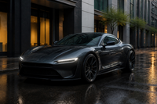
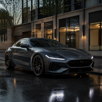

# Концепт-купе премиум-класса: фотореалистичное изображение

Сгенерировано в Canva AI (`generate-image`) по ТЗ ниже. Промпт передан дословно.

## Результат

| | Вариант B — **основной** | Вариант A — запасной |
|---|---|---|
| Превью |  |  |
| Полный размер | [Открыть в Canva](https://www.canva.com/M/MAHaHY6o6NI) | [Открыть в Canva](https://www.canva.com/M/MAHaHQO2n2w) |
| Разрешение | 1536 × 1024, 3:2 | 1264 × 1264, 1:1 |
| Canva media id | `MAHaHY6o6NI` | `MAHaHQO2n2w` |

Файлы в `previews/` — это только миниатюры 200 px. Полноразмерные изображения лежат в Canva
(ссылки выше → «Скачать»). Из окружения, где шла работа, сетевая политика не пускает
к хостам загрузки Canva (`media.canva.com`, `export-download.canva.com` отвечают 403),
поэтому положить в репозиторий полноразмерные файлы не получилось.

## Почему основной — вариант B

- **Кадр 3:2** — родной формат полнокадровой камеры. Машина целиком, вокруг есть воздух,
  как в рекламной съёмке. В квадрате A бампер и корма почти упираются в края кадра.
- **Камера ниже.** В B горизонт проходит примерно на уровне фар, капот не «раскрыт» сверху,
  получается тот самый низкий героический ракурс. В A горизонт выше фар: камера стоит
  над ними, а не под ними.
- **Нет логотипов.** Нос B чистый: узкая полоса светодиодных фар и нижний воздухозаборник,
  ни одной эмблемы. В A по центру решётки и на носу капота видны значки, похожие на
  логотип, а ТЗ это прямо запрещает.
- На превью силуэт B не похож на какую-то конкретную серийную модель. Решётка A
  с эмблемой по центру ближе к узнаваемым серийным машинам.

## Сверка с ТЗ (вариант B, по превью)

- [x] Спортивное купе, широкие колёсные арки, проработанные пороги и воздухозаборники
- [x] Тёмный графит с металлическим блеском, отражения зданий и неба на кузове
- [x] Узкие светодиодные фары, тонкая световая подпись
- [x] Крупные многоспицевые кованые диски, колёса круглые, без искажений
- [x] Ракурс три четверти спереди, камера низко
- [x] Пустая современная улица после дождя, вечерний свет, мокрый асфальт с отражениями
- [x] Без текста, логотипов, водяных знаков и людей
- [ ] Протектор, зазоры панелей, дверные ручки и суппорты нужно смотреть в полном размере
  в Canva: на миниатюре 200 px их не разглядеть.

## ТЗ (промпт, дословно)

> Создай фотореалистичный дизайн концептуального автомобиля премиум-класса: современное спортивное купе с выразительным, узнаваемым силуэтом, широкими колёсными арками и тщательно проработанной аэродинамикой. Кузов тёмного графитового цвета с глубоким металлическим блеском. Узкие светодиодные фары, элегантная световая подпись, крупные кованые диски и качественная резина с реалистичным рисунком протектора.
>
> Покажи автомобиль целиком в ракурсе три четверти спереди, камера расположена немного ниже уровня фар. Съёмка на пустой современной улице после дождя, мягкий вечерний свет, естественные отражения зданий и неба на кузове, влажный асфальт с тонкими отражениями фар. Дизайн должен выглядеть как реальный автомобиль, готовый к производству: правдоподобные пропорции, точные стыки кузовных панелей, реалистичные зеркала, дверные ручки и тормозные механизмы.
>
> Уровень исполнения — профессиональная автомобильная рекламная фотография. Высокая детализация, физически корректное освещение и материалы, естественная цветопередача, резкий фокус на автомобиле, мягкая глубина резкости. Изображение должно выглядеть как настоящая фотография, снятая на полнокадровую камеру с объективом 35 мм.
>
> Без текста, логотипов, водяных знаков, людей, мультяшности, чрезмерной ретуши, искажённых колёс и нереалистичных деталей.

Параметры генерации: вариант A — без указания формата (по умолчанию 1:1),
вариант B — `aspectRatio: LANDSCAPE_3_2`.
